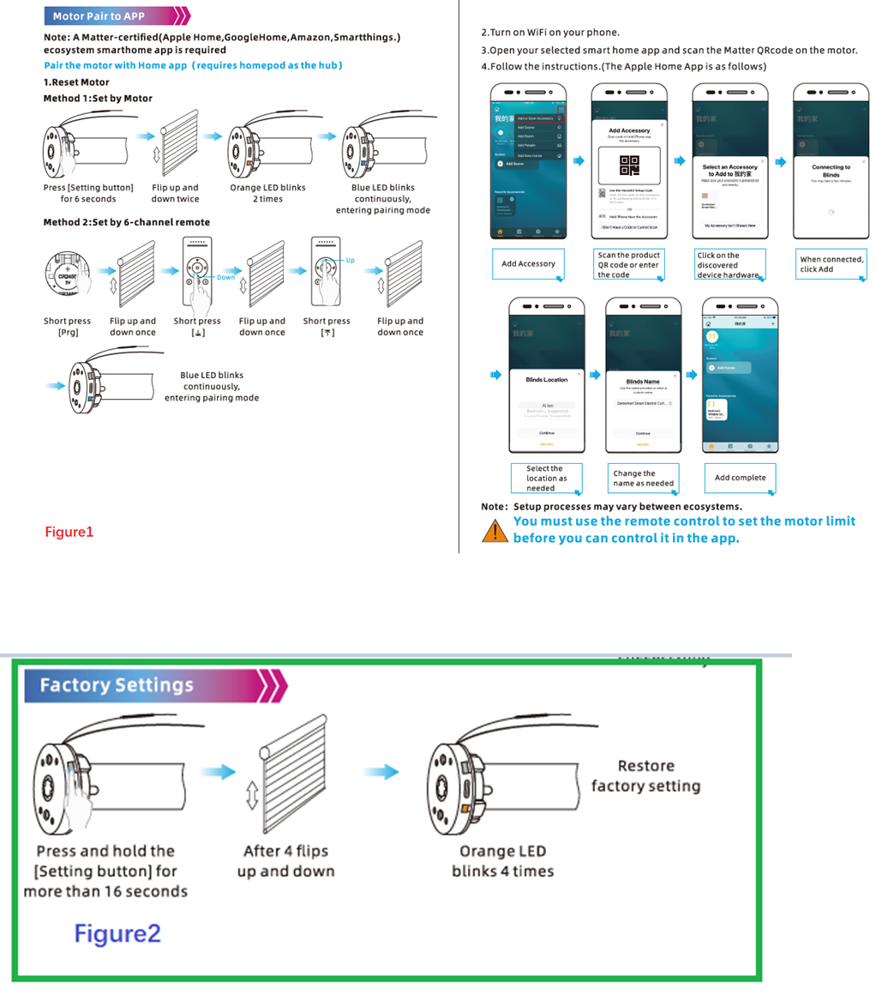
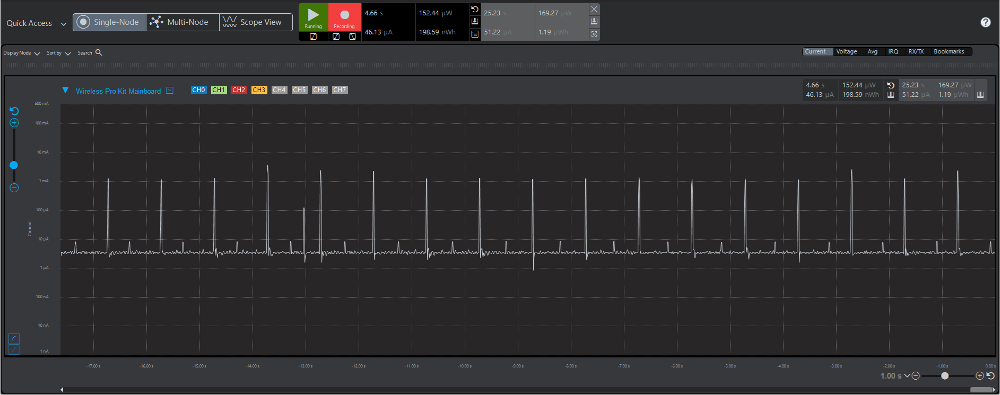
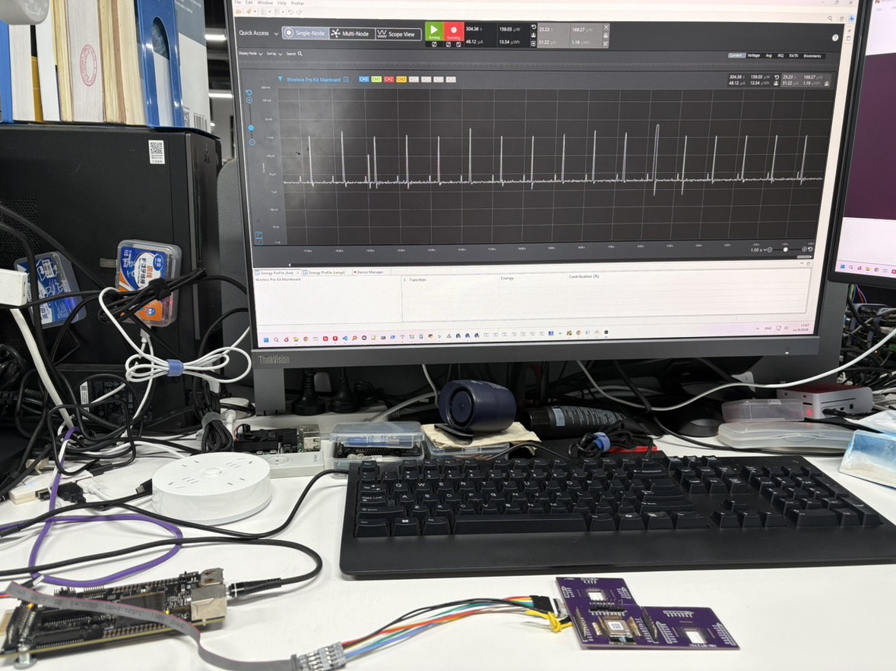
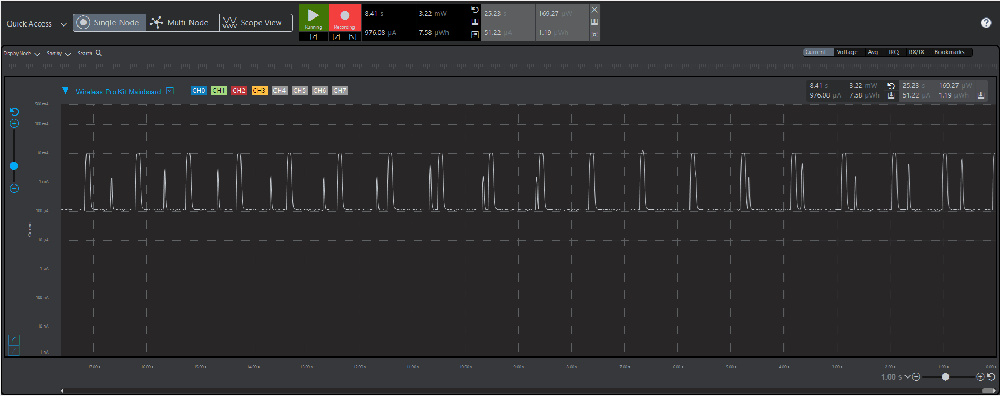
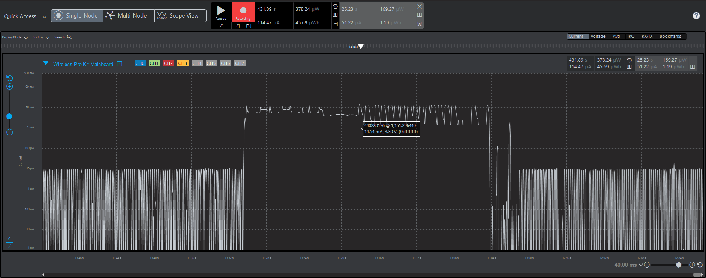
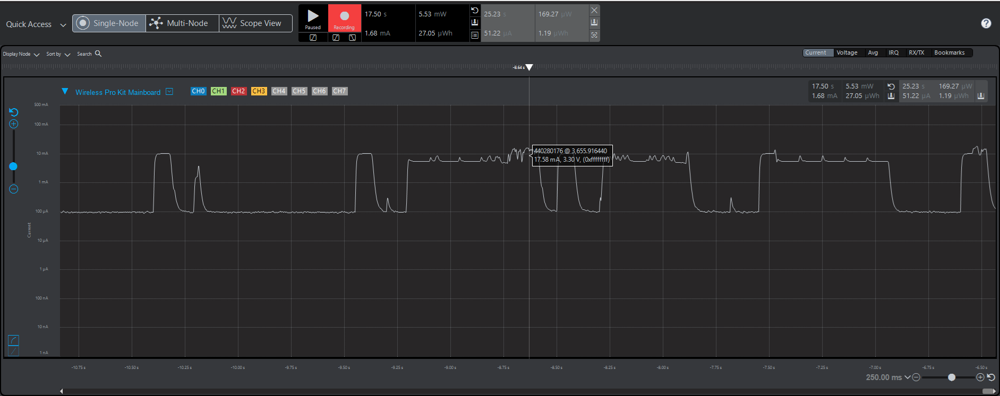
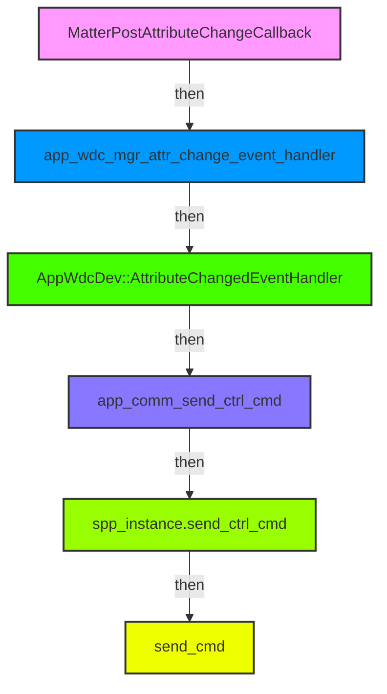
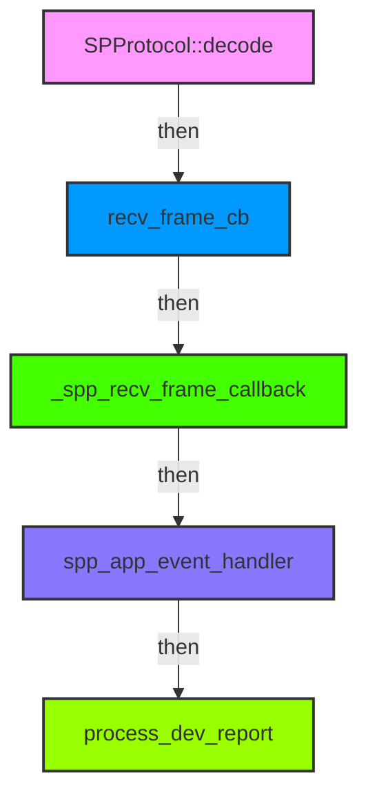
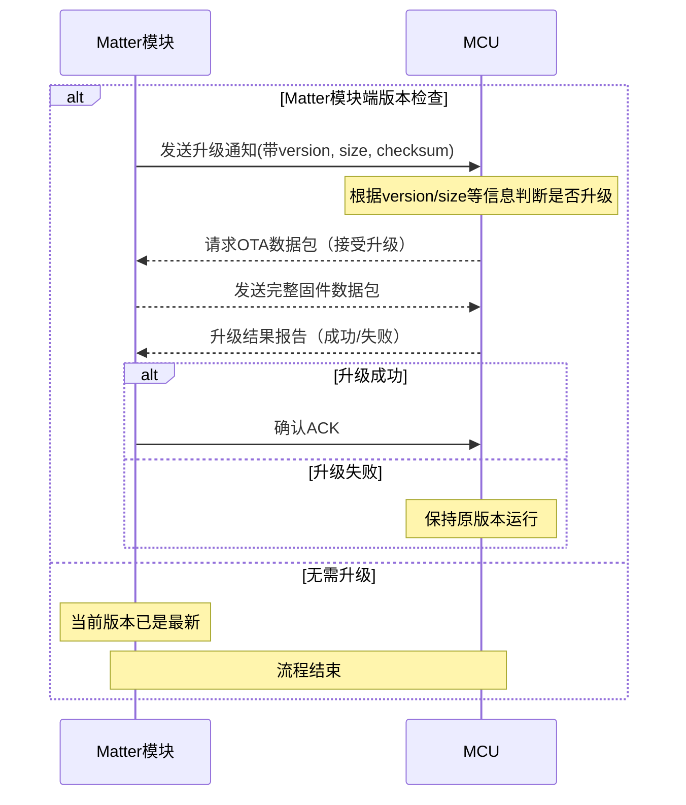
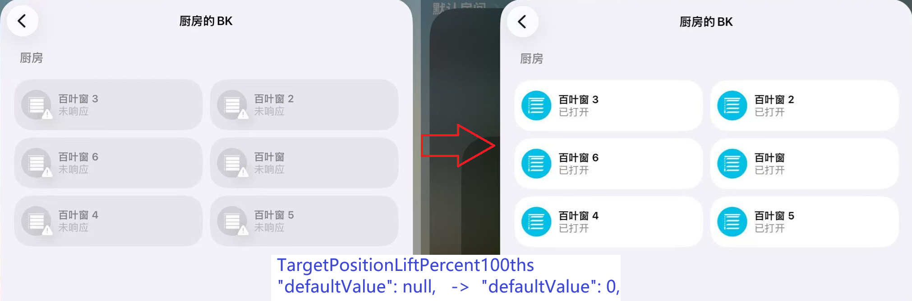

[hrf](hrf.md)  
[reset](./files/bk/reset.md)  
[requirement](./files/bk/requirement.md)  
[sn](./files/bk/sn.md)  

# 保康 Matter 窗帘电机

## 项目信息

### PartNo.
```c
HM-MT2401B-HPBK01
EFR32MG24A410F1536IM40
```

### 联系人
```c
//保康,
@吴北瓜(CCWu) 主管
@蔡工 软件工程师蔡工
@从此醉 硬件工程师李工
@Edward Chan 市场部负责人
//保康外包(AiWT/爱物通)
@日志Richy 软件外包商李总。
//华普微
@石韧 华普微Matter孙总
@lin
@flight
```

### 地址
```c
//保康
地址：广东省东莞市樟木头镇文裕路8号，东莞保康电子科技有限公司
联系人：吴长春
电话：13620049295
```
```c
//保康外包(爱物通)
地址：深圳市宝安区西乡街道共乐社区铁仔路60号奋成智谷大厦A座1303C
联系人：李日志
电话：18938674968
```

### Ones
[保康Matter窗帘电机](https://ones.cn/wiki/#/team/VocipTXV/space/7jKfDSiJ/page/UAgVbQvf)

<div align="left">
  
</div>

## Cert
### TUV
 - Provide sample device at Oct 13(SF1565290237573)
 - TUV test finish with all pass at Nov 9
### BLE
- Core Spec v6.0，QDID: **Q332743** & **Q317849**
- Listing: [Q366996](https://qualification.bluetooth.com/ListingDetails/303046)
- [BLE Core Spec Version](https://docs.silabs.com/bluetooth/latest/bluetooth-qualification/02-bluetooth-qualification#scenario-a-product-listing-using-existing-core-layer-designs)
- [Bluetooth 6.1-compliant stack](https://docs.silabs.com/bluetooth/11.0.2/sisdk-bt-release-notes/#bluetooth-le-version-11-0-2-release-notes-may-4-2026)

```c
[10:37:52.346]  [00:00:00.164][info  ][DL] Bluetooth stack booted: v11.0.2-b0
[10:37:52.346]  [00:00:00.164][info  ][DL] RAIL version:, v3.0.3-b0

[10:37:52.359]  [00:00:00.173][silabs ]CTM: Ver: 14 Build:  # Time:Nov  4 2026 11:38:09
[10:37:52.361]  [00:00:00.178][silabs ]CTM: Btl Ver: core: v3.2 user: v2
```

| SoCs, Modules, Dev. Kits boards | RFPHY Design # | Other Controller Layers and Host Design # | BLE SDK version and SiSDK |
|---------------------------------|----------------|-------------------------------------------|---------------------------|
| xG24                            | [Q332743](https://qualification.bluetooth.com/ListingDetails/258839) | [Q317849](https://qualification.bluetooth.com/ListingDetails/240988) | 9.0.0 and above for SiSDK 2024.12 and above |

### [Thread](https://docs.silabs.com/openthread/latest/thread-fundamentals/14-thread-certification-overview)
- V1.4
- CID: 14A633、14A376（Parent Product, SDK）

## Power Consumption
### Idle module
<div align="left">
  
</div>
<div align="left">
  
</div>

### Idle set
<div align="left">
  
</div>

### Active module
<div align="left">
  
</div>
<div align="left">
  
</div>

## Serial Protocol

### TX 调用链


### RX 调用链


### MCU OTA 协议（MCU DFU）
jlink 烧录：没有 bootloader 的话，地址要偏移 0x2000



### Boot Log
```c
[11:02:34.931]  [00:00:00.063][info  ][DL] Starting scheduler
[11:02:34.931]  [00:00:00.063][info  ][DL] ==================================================
[11:02:34.932]  [00:00:00.063][info  ][DL]  starting
[11:02:34.932]  [00:00:00.063][info  ][DL] ==================================================
[11:02:34.934]  [00:00:00.063][info  ][DL] Init CHIP Stack
[11:02:34.934]  [00:00:00.065][info  ][DL] Provision mode disabled
[11:02:34.934]  [00:00:00.065][info  ][DL] Initializing OpenThread stack
[11:02:34.935]  [00:00:00.066][info  ][DL] OpenThread started: OK
[11:02:34.935]  [00:00:00.066][info  ][DL] Setting OpenThread device type to SLEEPY END DEVICE
[11:02:34.938]  [00:00:00.094][info  ][DL] Bluetooth stack booted: v11.0.2-b0
[11:02:34.938]  [00:00:00.094][info  ][DL] RAIL version:, v3.0.3-b0
[11:02:34.941]  [00:00:00.095][info  ][DL] _OnPlatformEvent default:  event->Type = 32779
[11:02:34.941]  [00:00:00.095][info  ][SVR] Current Software Version String: 0.0.14
[11:02:34.942]  [00:00:00.096][info  ][SVR] Current Software Version: 14
[11:02:34.942]  [00:00:00.096][info  ][DL] Device Configuration:
[11:02:34.943]  [00:00:00.096][info  ][DL]   Serial Number: 38398FFFFE523903
[11:02:34.943]  [00:00:00.096][info  ][DL]   Vendor Id: 65521 (0xFFF1)
[11:02:34.945]  [00:00:00.097][info  ][DL]   Product Id: 32784 (0x8010)
[11:02:34.945]  [00:00:00.097][info  ][DL]   Product Name: SL_Sample
[11:02:34.945]  [00:00:00.097][info  ][DL]   Hardware Version: 1
[11:02:34.946]  [00:00:00.097][info  ][DL]   Setup Pin Code (0 for UNKNOWN/ERROR): 0
[11:02:34.946]  [00:00:00.098][info  ][DL]   Setup Discriminator (0xFFFF for UNKNOWN/ERROR): 3840 (0xF00)
[11:02:34.947]  [00:00:00.098][info  ][DL]   Manufacturing Date: 2026-05-29
[11:02:34.949]  [00:00:00.098][info  ][DL]   Device Type: 65535 (0xFFFF)
[11:02:34.949]  [00:00:00.099][info  ][SVR] SetupQRCode: [MT:SAGA442C00KA0648G00]
[11:02:34.950]  [00:00:00.099][info  ][SVR] Copy/paste the below URL in a browser to see the QR Code:
[11:02:34.950]  [00:00:00.099][info  ][SVR] https://project-chip.github.io/connectedhomeip/qrcode.html?data=MT%3ASAGA442C00KA0648G00
[11:02:34.951]  matterCli> [00:00:00.105][silabs ]CTM: Ver: 14 Build:  # Time:Nov  4 2026 11:38:09
[11:02:34.955]  [00:00:00.110][silabs ]CTM: Btl Ver: core: v3.2 user: v2
[11:02:34.962]  [00:00:00.115][silabs ]CTM: ResetCause: 0x00000002 (bit: WDOG0=0 LOCKUP=0 SYSREQ=0 PIN=1 POR=0)
[11:02:34.966]  [00:00:00.120][silabs ] Tx power 10dBm
[11:02:34.970]  [00:00:00.125][silabs ]SetupQRCode: [MT:SAGA442C00KA0648G00]
[11:02:34.970]  [00:00:00.125][silabs ]COM: Init done
[11:02:34.970]  [00:00:00.125][silabs ]app_mcu_dfu_init: spawning async init thread
[11:02:34.972]  [00:00:00.126][silabs ]NWK: open basic commissioning window time 300 sec
[11:02:34.975]  [00:00:00.128][info  ][DIS] Updating services using commissioning mode 1
[11:02:34.975]  [00:00:00.128][error ][DIS] Failed to remove advertised services: 3
[11:02:34.977]  [00:00:00.131][info  ][DIS] Advertise commission parameter vendorID=65521 productID=32784 discriminator=3840/15 cm=1 cp=0 jf=0
[11:02:34.978]  [00:00:00.131][error ][DIS] Failed to advertise commissionable node: 3
[11:02:34.978]  [00:00:00.131][error ][DIS] Failed to finalize service update: 3
[11:02:34.980]  [00:00:00.134][info  ][DL] BLE Static Device Address C1:3D:20:0A:EB:6C
[11:02:34.980]  [00:00:00.135][info  ][DL] Starting advertising with interval_min=32, intverval_max=96 (units of 625us)
[11:02:34.981]  [00:00:00.136][info  ][DL] _OnPlatformEvent default:  event->Type = 32781
[11:02:34.982]  [00:00:00.136][silabs ]NWK: kCHIPoBLEAdvertisingChange,32781
[11:02:34.982]  [00:00:00.137][silabs ]mcu_dfu_init_thread_func start
[11:02:34.983]  [00:00:00.137][silabs ]waiting for MCU version...
[11:02:34.983]  [00:00:00.137][silabs ]COM: notify network [Leave]
[11:02:34.983]  [00:00:00.137][silabs ]CLS: register device: dev 0x2002a256 endpoint 1 type 0 idx 1
[11:02:34.985]  [00:00:00.139][silabs ]App Task started
```
### OTA log
```c
COM: Boot OTA check - MCU: 0.0.1, Metadata: 3.0.0
COM: Notify MCU OTA upgrade: cmd=0xE1, PID=0x0001, Ver=3.0.0, size=45676, checksum=0x25
MATTER TX: 55 AA 01 03 0E E1 0A 00 01 33 2E 30 2E 30 B2 6C 25 2F
```

#### 解析
```c
55 AA 01 03 0E  //header&SN
E1              //cmd=0xE1
0A              //len
00 01           //PID=0x0001
33 2E 30 2E 30  //Ver=3.0.0
B2 6C           //size=45676
25              //MCU FW checksum=0x25
2F              //checksum=0x25
```

### MCU Version 获取时序

开机后两条请求路径 + 一条应答路径：

1. **路径 A：comm_mgr 开机查询**（立即，只发一次）
   - AppTask.cpp:97-98：AppInit() 里 app_comm_mgr_init() → app_mcu_dfu_init() 依次调用
   - app_comm_mgr.cpp:99：app_comm_mgr_start() 里 ev_set_delay_ms(&query_device_event, 0) → 事件立即触发一次
   - app_comm_mgr.cpp:143-151：_query_device_event_handler 中，若 app_spm_is_init_done() 为 false（还没收到 MCU 上报），就发 kGetProductInfo（0x01）给 MCU
   - ⚠️ 重发那行被注释掉了（app_comm_mgr.cpp:152），所以这条路开机只发一次，失败不重试
2. **路径 B：DFU 线程兜底查询**（启动时，最多等 30s）
   - app_mcu_dfu.cpp:275-289：mcu_dfu_init_thread_func 启动时，若 app_mcu_dfu_is_version_valid() 为 false：
     - 再发一次 kGetProductInfo
     - 轮询 300 × 100ms = 30s 等 version 变 valid
     - 30s 还没有 → 打日志 "will retry on trigger"，先进入正常轮询循环
3. **应答路径**：version 真正被写入的时刻。MCU 回包后走分发表（app_spm_mgr.cpp:776），两个入口都会写 version：

   | 入口 | 位置 | 触发时机 |
   |---|---|---|
   | spp_app_event_GetProductInfo | app_spm_mgr.cpp:491 | 回应上面的 0x01 查询 |
   | spp_app_event_OTAVersionRequest | app_spm_mgr.cpp:668 | MCU 主动请求 OTA 版本 |

   两者都解析 JSON 里的 x.x.x（失败还有逐字符 fallback），调 app_mcu_dfu_set_current_version()（app_mcu_dfu.cpp:543）→ 置 s_current_version_valid = true
4. **使用时刻**：Matter OTA 触发后（OTATriggerMeteFwUpgrade），DFU 线程读 metadata header、做版本比较（app_mcu_dfu.cpp:361-375）；version 仍无效则跳过 MCU 升级直接走 Matter 镜像 apply

一句话总结：开机瞬间 comm_mgr 发一次 kGetProductInfo，DFU 线程紧接着再发一次并等最多 30s；MCU 回包（GetProductInfo 或 OTAVersionRequest）解析 JSON 版本号成功的那一刻，s_current_version_valid 才变 true。

## OTA

### 版本对应（Matter & MCU）
| Matter | MCU |
|---|---|
|v0.0.4|v300|
|v0.0.5|v111|
|v0.0.6|v124|
|v0.0.7|v125|
|v0.0.8|v---|
|v0.0.9|v126|
|v0.0.10|v126|
|v0.0.14|v126|

### OTA Time
```c
//1112seconds -> 18.5minutes
```
11:28:48.021
11:17:50.364

### Bootloader

#### Config 修改
```c
//config/btl_interface_cfg_s2c4.h
#define BOOTLOADER_DISABLE_OLD_BOOTLOADER_MITIGATION 0
// |
// V
#define BOOTLOADER_DISABLE_OLD_BOOTLOADER_MITIGATION 1
```

#### Invoke track
```c
bootloader_verifyImage(0,NULL/metadataCallback)
    bootloader_initVerifyImage()
    bootloader_continueVerifyImage()
```

#### Metadata Callback
```c
//third_party/matter_sdk/src/platform/silabs/efr32/OTAImageProcessorImpl.cpp
#ifndef MIN
#define MIN(x, y) (((x) < (y)) ? (x) : (y))
#endif
#define MAX_METADATA_LENGTH   512
uint8_t metadata[MAX_METADATA_LENGTH];

void metadataCallback(uint32_t address, uint8_t *data, size_t length, void *context)
{
    uint8_t i;
    ChipLogError(SoftwareUpdate, "%s", __func__);
    for (i = 0; i < MIN(length , MAX_METADATA_LENGTH - address); i++)
    {
        metadata[address + i] = data[i];
        ChipLogError(SoftwareUpdate, "[%ld]:%d", (address + i), metadata[address + i]);
    }
}
void OTAImageProcessorImpl::HandleApply(intptr_t context)
{
    uint32_t err = SL_BOOTLOADER_OK;

    ChipLogProgress(SoftwareUpdate, "HandleApply: verifying image");
    SILABS_TRACE_BEGIN(TimeTraceOperation::kImageVerification);

    // Force KVS to store pending keys such as data from StoreCurrentUpdateInfo()
    PersistedStorage::KeyValueStoreMgrImpl().ForceKeyMapSave();
#if SL_BTLCTRL_MUX
    err = sl_wfx_host_pre_bootloader_spi_transfer();
    if (err != SL_STATUS_OK)
    {
        ChipLogError(SoftwareUpdate, "sl_wfx_host_pre_bootloader_spi_transfer() error: %ld", err);
        SILABS_TRACE_END_ERROR(TimeTraceOperation::kImageVerification, CHIP_ERROR_INTERNAL);
        return;
    }
#endif // SL_BTLCTRL_MUX

#if defined(_SILICON_LABS_32B_SERIES_3) && CHIP_PROGRESS_LOGGING
    osDelay(100); // sl-temp: delay for uart print before verifyImage
#endif            // _SILICON_LABS_32B_SERIES_3 && CHIP_PROGRESS_LOGGING
    LockRadioProcessing();
#if defined(SL_TRUSTZONE_NONSECURE)
    WRAP_BL_DFU_CALL(err = bootloader_verifyImage(mSlotId))
#else
    WRAP_BL_DFU_CALL(err = bootloader_verifyImage(mSlotId, metadataCallback)) //NULL
#endif
    UnlockRadioProcessing();
```

```c
// src\app\AppTask.cpp
#define MIN(a, b) ((a) < (b) ? (a) : (b))
#define MAX_METADATA_LENGTH   512
uint8_t metadata[MAX_METADATA_LENGTH];

void metadataCallback(uint32_t address, uint8_t *data, size_t length, void *context)
{
    uint8_t i;
    LOG_API_HEX("metadata", data, length);
    return;
    for (i = 0; i < MIN(length , MAX_METADATA_LENGTH - address); i++)
    {
        metadata[address + i] = data[i];
    }
}

CHIP_ERROR AppTask::AppInit()
{
    //...
    DeviceLayer::ThreadStackMgr().LockThreadStack();
    wdg_api_disable();
    CORE_ATOMIC_SECTION(
    uint32_t bootloader_err  = bootloader_init();
    if (bootloader_err != 0){
        SILABS_LOG("bootloader_init() error: %ld", bootloader_err);
    }
    bootloader_err = bootloader_verifyImage(0, metadataCallback);
    if (bootloader_err != 0){
        SILABS_LOG("bootloader_verifyImage() error: %ld", bootloader_err);
    }
    );
    wdg_api_enable();
    DeviceLayer::ThreadStackMgr().UnlockThreadStack();
    //...
}
```

#### UNKNOWN_TAG 错误
```c
#define BOOTLOADER_ERROR_PARSER_UNKNOWN_TAG \
  (BOOTLOADER_ERROR_PARSER_BASE | 0x08L)

//Silabe bootloader_verifyImage
[silabs ]bootloader_verifyImage() error: 4104 ->0x1008-> BOOTLOADER_ERROR_PARSER_UNKNOWN_TAG
```

#### Debug：栈溢出 HardFault（vListInsert）
```c
void vListInsert(List_t * const pxList,
                 ListItem_t * const pxNewListItem)
{
  ListItem_t * pxIterator;
  const TickType_t xValueOfInsertion = pxNewListItem->xItemValue;

  traceENTER_vListInsert(pxList, pxNewListItem);

  /* Only effective when configASSERT() is also defined, these tests may catch
   * the list data structures being overwritten in memory.  They will not catch
   * data errors caused by incorrect configuration or use of FreeRTOS. */
  listTEST_LIST_INTEGRITY(pxList);
  listTEST_LIST_ITEM_INTEGRITY(pxNewListItem);

  /* Insert the new list item into the list, sorted in xItemValue order.
   *
   * If the list already contains a list item with the same item value then the
   * new list item should be placed after it.  This ensures that TCBs which are
   * stored in ready lists (all of which have the same xItemValue value) get a
   * share of the CPU.  However, if the xItemValue is the same as the back marker
   * the iteration loop below will not end.  Therefore the value is checked
   * first, and the algorithm slightly modified if necessary. */
  if ( xValueOfInsertion == portMAX_DELAY ) {
    pxIterator = pxList->xListEnd.pxPrevious;
  } else {
    /* *** NOTE ***********************************************************
    *  If you find your application is crashing here then likely causes are
    *  listed below.  In addition see https://www.FreeRTOS.org/FAQHelp.html for
    *  more tips, and ensure configASSERT() is defined!
    *  https://www.FreeRTOS.org/a00110.html#configASSERT
    *
    *   1) Stack overflow -
    *      see https://www.FreeRTOS.org/Stacks-and-stack-overflow-checking.html
    *   2) Incorrect interrupt priority assignment, especially on Cortex-M
    *      parts where numerically high priority values denote low actual
    *      interrupt priorities, which can seem counter intuitive.  See
    *      https://www.FreeRTOS.org/RTOS-Cortex-M3-M4.html and the definition
    *      of configMAX_SYSCALL_INTERRUPT_PRIORITY on
    *      https://www.FreeRTOS.org/a00110.html
    *   3) Calling an API function from within a critical section or when
    *      the scheduler is suspended, or calling an API function that does
    *      not end in "FromISR" from an interrupt.
    *   4) Using a queue or semaphore before it has been initialised or
    *      before the scheduler has been started, or are interrupts firing
    *      before vTaskStartScheduler() has been called?
    *   5) If the FreeRTOS port supports interrupt nesting then ensure that
    *      the priority of the tick interrupt is at or below
    *      configMAX_SYSCALL_INTERRUPT_PRIORITY.
    **********************************************************************/

    for ( pxIterator = ( ListItem_t * ) &(pxList->xListEnd); pxIterator->pxNext->xItemValue <= xValueOfInsertion; pxIterator = pxIterator->pxNext ) {
      /* There is nothing to do here, just iterating to the wanted
       * insertion position. */
    }
  }

  pxNewListItem->pxNext = pxIterator->pxNext;
  pxNewListItem->pxNext->pxPrevious = pxNewListItem;
  pxNewListItem->pxPrevious = pxIterator;
  pxIterator->pxNext = pxNewListItem;

  /* Remember which list the item is in.  This allows fast removal of the
   * item later. */
  pxNewListItem->pxContainer = pxList;

  (pxList->uxNumberOfItems) = ( UBaseType_t ) (pxList->uxNumberOfItems + 1U);

  traceRETURN_vListInsert();
}
```

栈消耗路径：
```c
AppTaskMain (4KB stack)
  └─ AppInit()
       └─ app_mcu_dfu_init()
            └─ cache_entire_metadata()
                 ├─ SILABS_LOG(...)            ← 消耗栈
                 ├─ bootloader_initVerifyImage  ← 消耗栈
                 └─ bootloader_continueVerifyImage loop  ← 消耗栈
                      └─ cache_append_callback  ← 消耗栈
                           └─ memcpy()          ← 消耗栈
```

崩溃调用栈（addr2line）：
```c
??@0x08003b44 (Unknown Source:0)
bootloader_continueVerifyImage@0x08034454 (c:\Users\huide\.silabs\slt\installs\conan\p\simpl35774a752829c\p\bootloader_interface\platform\bootloader\api\btl_interface_storage.c:473)
bootloader_continueVerifyImage@0x08034454 (c:\Users\huide\.silabs\slt\installs\conan\p\simpl35774a752829c\p\bootloader_interface\platform\bootloader\api\btl_interface_storage.c:461)
cache_entire_metadata@0x08057fbe (c:\Si\v6\bk01_matter\src\app\app_mcu_dfu.cpp:196)
app_mcu_dfu_init@0x0805815c (c:\Si\v6\bk01_matter\src\app\app_mcu_dfu.cpp:315)
AppTask::AppInit@0x080597a0 (c:\Si\v6\bk01_matter\src\app\AppTask.cpp:104)
BaseApplication::Init@0x08007910 (c:\Users\huide\.silabs\slt\installs\conan\p\matte8bada656e9e76\p\third_party\matter_sdk\examples\platform\silabs\BaseApplication.cpp:311)
AppTask::AppTaskMain@0x080595de (c:\Si\v6\bk01_matter\src\app\AppTask.cpp:137)
SystemHFXOClockSet@0x08034734 (c:\Users\huide\.silabs\slt\installs\conan\p\simpl35774a752829c\p\devices\platform\Device\SiliconLabs\EFR32MG24\Source\system_efr32mg24.c:506)
```

复位原因链：
```c
continueVerifyImage 解析非法数据
  → 访问非法地址 / 非法内存操作
    → HardFault / BusFault
      → fault handler → NVIC_SystemReset()
        → EMU_RSTCAUSE_SYSREQ (0x40)
```

#### Fixed
```c
#define BOOTLOADER_DISABLE_NVM3_FAULT_HANDLING 0
|
V
#define BOOTLOADER_DISABLE_NVM3_FAULT_HANDLING 1
```

## ZAP / Cluster

### Covering app iOS bug
```c
config\common\window-app.zap
            {
              "name": "TargetPositionLiftPercent100ths",
              "code": 11,
              "mfgCode": null,
              "side": "server",
              "type": "percent100ths",
              "included": 1,
              "storageOption": "RAM",
              "singleton": 0,
              "bounded": 0,
              "defaultValue": null,
              "reportable": 1,
              "minInterval": 0,
              "maxInterval": 65344,
              "reportableChange": 0
            },
```
```c
"defaultValue": null,
    |
    V
"defaultValue": 0,
```
<div align="left">
  
</div>

### Battery indicate on App
```c
        {
          "name": "Power Source",
          "code": 47,
          "mfgCode": null,
          "define": "POWER_SOURCE_CLUSTER",
          "side": "server",
          "enabled": 1,
          "attributes": [
            ...
                        {
              "name": "FeatureMap",
              "code": 65532,
              "mfgCode": null,
              "side": "server",
              "type": "bitmap32",
              "included": 1,
              "storageOption": "RAM",
              "singleton": 0,
              "bounded": 0,
              "defaultValue": "0",
              "reportable": 1,
              "minInterval": 1,
              "maxInterval": 65534,
              "reportableChange": 0
            },
            ...

```
```c
"defaultValue": "0",
    |
    V
"defaultValue": "6",
```

#### Reference
```c
23-27349-009_Matter-1.5-Core-Specification.pdf
    11.7. Power Source Cluster
        11.7.4. Features
```
|Bit |Code |Feature |Conformance |Summary|
| ---- | ---- | ---- | ---- | ---- |
|0 |WIRED |Wired |O.a |A wired power source|
|1 |BAT |Battery |O.a |A battery power source|
|2 |RECHG |Rechargeable |[BAT] |A rechargeable battery power source|
|3 |REPLC |Replaceable |[BAT] |A replaceable battery power source|

### BatPercentRemaining
```c
        uint8_t dev_battery = fdata[0] * 2;

        LOG_MSG_INFO(TAG_PWR, "report battery percent %u\n", fdata[0]);

        PlatformMgr().LockChipStack();
        matter_attr_lock();
        PowerSource::Attributes::BatPercentRemaining::Set(0, dev_battery);
        matter_attr_unlock();
        PlatformMgr().UnlockChipStack();
```

#### Reference
```c
23-27349-009_Matter-1.5-Core-Specification.pdf
    11.7. Power Source Cluster
        11.7.7. Attributes
            11.7.7.13. BatPercentRemaining Attribute
                This attribute SHALL indicate the estimated percentage of battery charge remaining until the
                battery will no longer be able to provide power to the Node. Values are expressed in half percent units,
                ranging from 0 to 200. E.g. a value of 48 is equivalent to 24%. A value of NULL SHALL indicate the
                Node is currently unable to assess the value.
```

### BatChargeLevel
```c
        uint8_t dev_battery_Charge_Level = fdata[0];

        LOG_MSG_INFO(TAG_PWR, "report battery Charge Level %u\n", fdata[0]);

        PlatformMgr().LockChipStack();
        matter_attr_lock();
        PowerSource::Attributes::BatChargeLevel::Set(0, dev_battery_Charge_Level);
        matter_attr_unlock();
        PlatformMgr().UnlockChipStack();
```

#### Reference
```c
23-27349-009_Matter-1.5-Core-Specification.pdf
    11.7. Power Source Cluster
        11.7.6. Data Types
            11.7.6.6. BatChargeLevelEnum Type
        11.7.7. Attributes
            ID: 0x000E Name: BatCharge Level
```
|Value |Name |Summary |Conformance|
| ---- | ---- | ---- | ---- |
|0 |OK |Charge level is nominal |M|
|1 |Warning |Charge level is low,intervention may soon be required.|M|
|2 |Critical |Charge level is critical,immediate intervention is required|M|

### BatChargeStatus
```c
        uint8_t dev_battery_Charge_Status = fdata[0];

        LOG_MSG_INFO(TAG_PWR, "report battery Charge Status %u\n", fdata[0]);

        PlatformMgr().LockChipStack();
        matter_attr_lock();
        PowerSource::Attributes::BatChargeState::Set(0, dev_battery_Charge_Status);
        matter_attr_unlock();
        PlatformMgr().UnlockChipStack();
```

#### Reference
```c
23-27349-009_Matter-1.5-Core-Specification.pdf
    11.7. Power Source Cluster
        11.7.6. Data Types
            11.7.6.10. BatChargeStateEnum Type
        11.7.7. Attributes
            ID: 0x001A Name: BatCharge State
```
|Value |Name |Summary |Conformance|
| ---- | ---- | ---- | ---- |
|0 |Unknown |Unable to determine the charging state|M|
|1 |IsCharging |The battery is charging |M|
|2 |IsAtFullCharge |The battery is at full charge|M|
|3 |IsNotCharging |The battery is not charging|M|

## 代码结构 Code

### 启动调用链
```c
main()-main.c
    app_init()-main.cpp
        SilabsMatterConfig::AppInit()-MatterConfig.cpp
            ApplicationStart()-MatterConfig.cpp
                AppTask::GetAppTask().StartAppTask()
                    BaseApplication::StartAppTask(AppTaskMain)
                        AppTask::AppTaskMain(void * pvParameter)
                            AppTask::AppInit()-AppTask.cpp
                                app_nwk_mgr_init()-app_nwk_mgr.cpp
                                    app_nwk_open_basic_commissioning_window()
                                        chip::Server::GetInstance().GetCommissioningWindowManager().OpenBasicCommissioningWindow()
```

## OS Thread

### 当前运行的线程（共 12 个）
|#	|线程名	|创建方式	|优先级	|栈大小	|创建位置|
|----|----|----|----|----|----|
|1	|Start Task	|osKernelStart() → SDK	|Normal (24)	|4096	|main.c:36 sl_main_second_stage_init()|
|2	|main (临时)	|osThreadNew	|Realtime7 (55)	|5120	|MatterConfig.cpp:239 → 初始化完自删|
|3	|App Task	|osThreadNew	|Normal (24)	|4096	|BaseApplication.cpp:292|
|4	|UART Task	|xTaskCreateStatic	|30	|UART_TASK_SIZE	|hal_uart.cpp:395|
|5	|BT Link Layer	|SDK sli_bt_rtos_adaptation_kernel_start	|52	|1000	|sl_bt_rtos_config_s2.h|
|6	|BT Host Stack	|SDK	|51	|2000	|sl_bt_rtos_config_s2.h|
|7	|BT Event Handler	|SDK	|50	|1536	|sl_bt_rtos_config_s2.h|
|8	|OT Stack Task	|SDK sl_ot_rtos_stack_init	|24	|4608	|sl_openthread_rtos_config.h|
|9	|OT App Task	|SDK sl_ot_rtos_app_init	|23	|4608	|sl_openthread_rtos_config.h|
|10	|OT Serial Task	|SDK	|16	|3840	|sl_openthread_rtos_config.h|
|11	|IDLE	|FreeRTOS 自动	|0 (最低)	|configMINIMAL_STACK_SIZE	|FreeRTOS 内核|
|12	|Timer Service	|FreeRTOS 自动	|55 (最高)	|1280	|FreeRTOSConfig.h:219|

### 启动流程
```c
main()
  └─ sl_main_second_stage_init()    // SDK 硬件/协议栈初始化
       ├─ osKernelStart()           // FreeRTOS 内核启动 (Start Task 诞生)
       ├─ sl_bt_* 线程创建           // 3个蓝牙线程
       ├─ sl_ot_* 线程创建           // 3个 OpenThread 线程
       └─ app_init()                // 用户初始化
            └─ SilabsMatterConfig::AppInit()
                 └─ osThreadNew(ApplicationStart)  // main 线程 (临时, 优先级最高)
                      ├─ InitMatter()              // Matter 协议栈初始化
                      └─ StartAppTask()            // App Task 创建
                           └─ osThreadNew(AppTaskMain)
                 └─ osThreadTerminate()            // main 线程自删
  └─ while(app_process_action())    // Start Task 进入事件循环
```

## Base Info

### CMD
```c
sudo ./chip-tool basicinformation read vendor-name 2256 0
sudo ./chip-tool basicinformation read product-name 2256 0
sudo ./chip-tool basicinformation read product-id 2256 0
sudo ./chip-tool basicinformation read part-number 2256 0
sudo ./chip-tool basicinformation read product-url 2256 0
sudo ./chip-tool basicinformation read product-label 2256 0
```

### BK
```c
        "vendor_name": "BK",
        "product_name": "Window Covering",
        "product_url": "http://www.automatic.com.hk/",
        "product_label": "Window Covering",
        "part_number": "Window Covering",
```

### HopeRF
```c
        "vendor_name": "HOPERF",
        "product_name": "Smart Window Covering",
        "product_url": "http://www.hoperf.com",
        "product_label": "Window Covering",
        "part_number": "HOPERF-SWC-BK01",
```

## Flash & RAM
```c
Ram usage       :   262140 /   262140 B (100.00 %)
  .bootloader_reset_section:        4 B            (  0.00 %)
  .bss          :   145016 B            ( 55.32 %)
  .data         :     3152 B            (  1.20 %)
  .memory_manager_heap:   108912 B            ( 41.55 %)
  .stack        :     4608 B            (  1.76 %)
  text_application_ram:      448 B            (  0.17 %)

Flash usage     :   960924 /  1540096 B ( 62.39 %)
```
### 正常需要多大 heap
heap 的真正消耗方（FreeRTOS pvPortMalloc / newlib malloc / chip Platform 动态分配全走这一个池子）：
Matter 层：PASE/CASE 会话状态、TLV scratch、exchange/会话对象——主要在配网和 CASE 建立瞬间冲高
 - BLE 栈动态分配
 - 应用侧 pvPortMalloc（比如 msg_mgr 的帧节点）
 - OpenThread 反而几乎不占 heap——OT 的 buffer/pool 是静态放 .bss 的（这就是你 .bss 145KB 的主要来源）。
经验值：这类 MG24 + Matter over Thread + BLE 设备，峰值大概 40–70 KB，最坏点在配网/BLE PASE 阶段。你现在剩 108KB，余量充足，不动它。

怎么确认而不是猜：在 AppInit、配网完成回调、长时间运行后各打一行水位：
```c
LOG_MSG_ERR(TAG_CTM, "heap min-ever-free %d", xPortGetMinimumEverFreeHeapSize());
```
Silabs GSDK 下 pvPortMalloc 已接到 memory manager，这个值就是全池最小余量。
最小余量 ≥ 池子的 15–20% 就安全。
由于 heap 本来就是"剩余 RAM"，缩它没有意义——除非你后面想把这 RAM 挪去做更大的静态池。

### FTD vs MTD 的区别
总 RAM 差 15–25KB，但差在 .bss 和任务栈，不在 heap。

 - FTD 多的是 OpenThread 的路由相关静态结构：RouterTable、NeighborTable、AddressResolver/Cache、更大的 OT 池，加上更大的 OT 任务栈
 - heap 需求基本一样——heap 大头是 Matter 会话/TLV、BLE、FreeRTOS，这些跟 FTD/MTD 无关

### GBL & OTA file
```c
commander gbl create "$gbl" --app "$fw" --compress lzma
```
|File  |Size |Remark |
| --- | --- | --- |
|.bin   |960,924 B (938KB)	|Flash usage: 960924/1540096 B ( 62.39 %)|
|.gbl	|565,116 B (552KB)	|LZMA compress，~60% .bin|
|.ota	|565,198 B	|GBL + 82 bytes Matter OTAHeader（VID / PID）|
