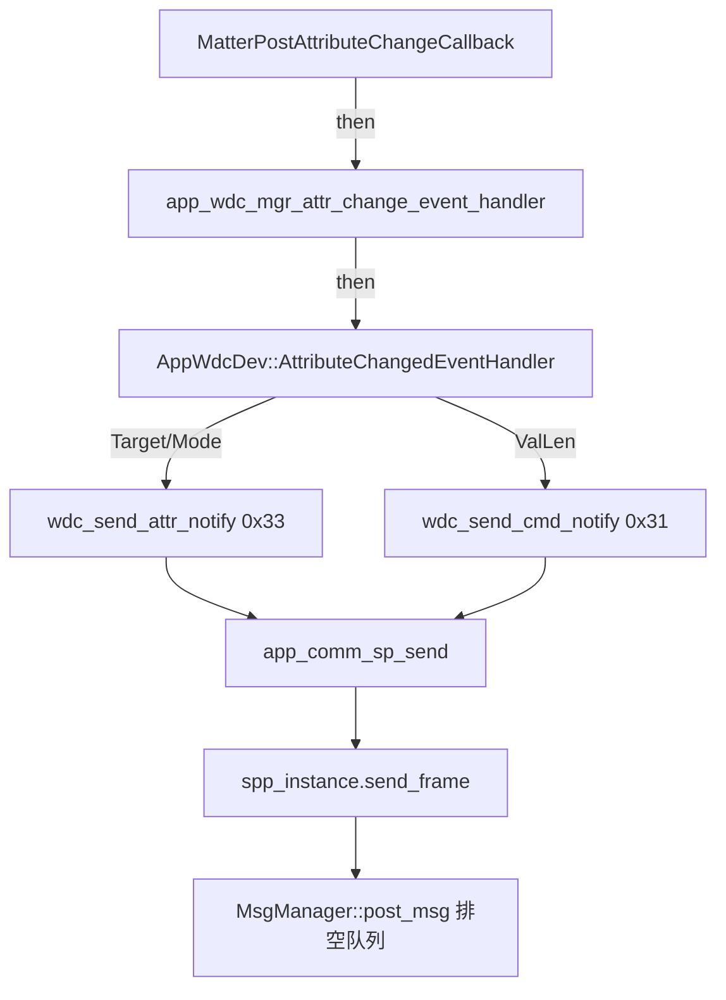
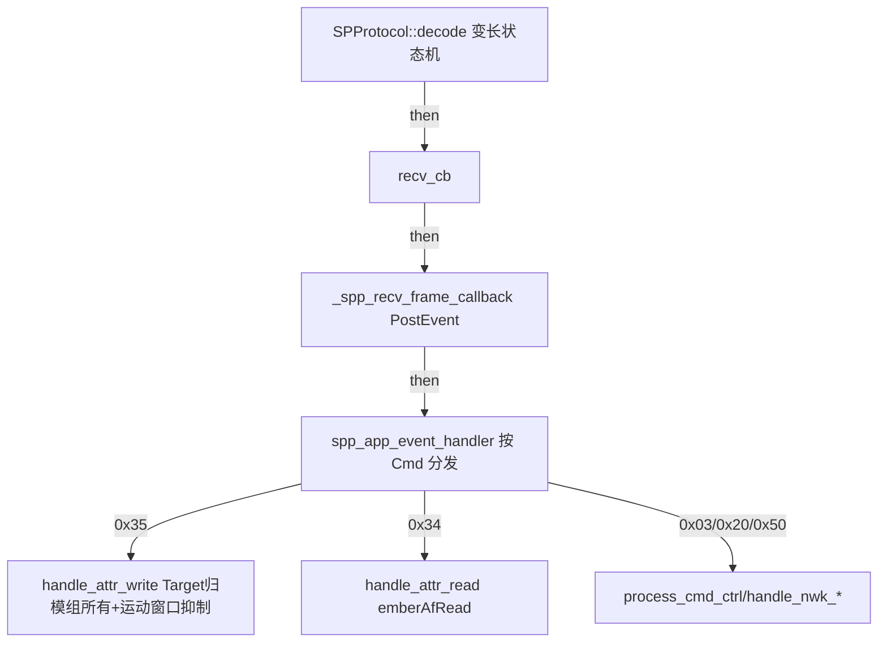

[dosron-serial-protocol](./files/dosron/dosron-serial-protocol.md)

# Dosron Matter 窗帘电机（dsr01_matter）

## 项目信息

```c
//EFR32MG24A410F1536IM40, SiSDK 2025.12.3, matter extension 2.8.1
//协议: Matter 模组 UART 通信协议 v1.0.7（标准协议，模组 TS24-U 对标）
C:\Si\v6\dsr01_matter
```

## Serial Port
```c
//VCom, PA5-TX, PA6-RX
Baudrate:921600
//Serial(MCU), PA3-TX, PA4-RX
Baudrate:9600-8-N-1, 无流控
//PC1: 模组发数据前拉低唤醒 MCU，发完拉高
//MCU 发送前需加 3 个 00 前导码
```

# Serial Protocol

## 帧格式
```c
|Front|Ver|Seq(2)|Cmd|Len(2)|Data(N)|Check|
|55AA |02 |大端  |1  |大端  |N      |累加和 mod 256|

Check = 从帧头起逐字节累加对 256 求余
回复帧沿用请求 Seq；主动通知自增 Seq（0~0xFFF0 回绕）
```

## 命令字覆盖
| 命令字 | 说明 | 方向 | 模组实现 |
|---|---|---|---|
| 0x02 | 网络状态通知 | 模组→MCU | ✓ 开机+状态变化主动下发，MCU 回空 ack |
| 0x03 | 配网/复位/离网 | MCU→模组 | ✓ 回 1B 状态；0x01 前须已回 0x30 |
| 0x08 | RF 测试 | MCU→模组 | 回失败（00 00，本 build 不做扫描）|
| 0x20 | 查询网络状态 | MCU→模组 | ✓ 回 1B 状态 |
| 0x24 | 时间同步 | MCU→模组 | 文档标注未实现，不回复 |
| 0x29 | 信标产测 | 模组→MCU | 未实现 |
| 0x30 | 查询设备能力 | 模组→MCU | ✓ 开机发送；MCU 必答后才可发 0x03 |
| 0x31 | 模组 CMD 通知 | 模组→MCU | ✓ UpOrOpen=00/DownOrClose=01/StopMotion=02 |
| 0x33 | 模组写属性 | 模组→MCU | ✓ EP+Cluster(4)+Attr(4)+Len(1)+Val(N) |
| 0x34 | MCU 读属性 | MCU→模组 | ✓ 逐条 emberAfReadAttribute |
| 0x35 | MCU 写属性 | MCU→模组 | ✓ 逐条写+逐条 status；统一回 00 防重发风暴 |
| 0x50 | 网络策略配置 | MCU→模组 | ✓ 心跳/配网超时/自组网持久化+回 0 后重启；poll 参数仅日志 |

## Window Covering 属性分工（EP1, Cluster 0x0102）
```c
TargetPositionLiftPercent100ths = 0x000B  // 控制意图方向，App/模组下发
CurrentPositionLiftPercent100ths= 0x000E  // 实际位置，MCU 上报
OperationalStatus               = 0x000A  // 00停/01开/02关
Mode                            = 0x0017  // bit0 反向
```

### MCU 0x35 上报约定
| 场景 | MCU 上报 |
|---|---|
| 第三方遥控设定新位置 | 一帧两条目：先 0x000B（新目标）再 0x000E（当前）|
| 运动中周期进度 | 只 0x000E（不碰 Target）|
| 到位 | 0x000E 终值 |
| 运动状态 | 0x000A（可选）|

## 运动关联窗口（mMotionActive）

```c
//模组转发运动命令（0x31/0x33 Target）后 mMotionActive=true（窗口开启）
//窗口关闭条件（任一先到）：
//  1. 超时：全行程 30s × 位移比例 + 2s（下限 3s）→ 吸附 Current=Target + 清 OpStatus
//  2. 到位：MCU 0x35 上报 Current == 本次命令目标 → 关窗
//  3. 停止：MCU 0x35 上报 OpStatus == 0 → 关窗
//窗口关闭后 MCU 上报的一切照写（= 外部遥控改动的主动同步）
```

### 窗口内/外 0x35 写入语义
| 窗口状态 | Current(0x000E) | Target(0x000B) | OpStatus(0x000A) |
|---|---|---|---|
| **窗口内**（命令后~到位前）| 不写，log 原因 | 不写，log 原因 | 不写，log 原因 |
| 窗口内 **Current==命令目标**（到位确认）| **写入收尾** + 解除抑制 + 关窗 | 解除后照写 | 解除后照写 |
| 窗口内 **OpStatus=0**（MCU 报停止）| — | — | **写入** + 解除抑制 |
| **窗口外**（无运动/运动已结束）| 照写 ✓ | 照写 ✓ | 照写 ✓ |

```c
//窗口内不写时 log 原因（每笔不写都有明确的日志行）：
0x35 Cur echo suppressed (motion window, passive echo v=6000)
0x35 Tgt echo suppressed (motion window, passive echo v=6000)
0x35 Op echo suppressed (motion window, passive echo s=2)
```

### HandleMovement 方向推导
```c
//WC server 传 type=Lift/Tilt（无方向），方向由模组从 Target vs Current 推导：
//  Target > Current → DownOrClose (CmdId=01)
//  Target < Current → UpOrOpen   (CmdId=00)
//  Target == Current → 不发（无位移）
//Current 为 null 按 0 处理
```

### HandleStopMotion 清理
```c
mMotionActive = false;
ev_set_inactive(&mMotionTimerEvent);
wdc_send_cmd_notify(m_ep, SP_WDC_CMD_STOPMOTION, NULL, 0);  // → 0x31 CmdId=02
OperationalStatus::Set(m_ep, BitMask<OperationalStatus>(0));  // 清运动状态
```

### 值域格式
```c
//Len 字段是属性类型逻辑长度（uint16=2），线上 Value 恒 4 字节大端
//例：50% = 00 00 13 88 → 取低16位 = 5000
```

## TX 调用链


## RX 调用链


## 0x35 按属性分发接口
```c
//WC cluster (0x0102) 各属性的模组侧处理：
switch (attr) {
case 0x000E Current: // 只写 0x0008 Percentage + 0x000E，不联动 Target
    CurrentPositionLiftPercentage::Set(ep, v/100);
    CurrentPositionLiftPercent100ths::Set(ep, v);
    break;
case 0x000B Target:  // 运动窗口内回声抑制，窗口外写入
    TargetPositionLiftPercent100ths::Set(ep, v);
    break;
case 0x0017 Mode:    // BitMask 写入
    Mode::Set(ep, BitMask<Mode>(raw & 0xFF));
    break;
case 0x000A OpStatus:// BitMask 写入
    OperationalStatus::Set(ep, BitMask<OpStatus>(raw & 0xFF));
    break;
default:             // 其它 WC 属性照写（emberAfWriteAttribute）
}
//所有写入都在 matter_attr_lock 内（抑制 MatterPostAttributeChangeCallback 回声）
```
### MCU data
```c
RX: 55 AA 02 00 09 02 00 00 0C 
RX: 55 AA 02 00 0A 02 00 00 0D 
RX: 55 AA 02 00 0B 35 00 48 
01 05 
00 00 01 02 00 00 00 0E 04 E7 00 00 00 00 //Current
00 00 01 02 00 00 00 17 04 18 00 00 00 00 //Mode
12 5D FC 31 12 5D 00 04 04 20 00 00 00 00 
12 5D FC 31 12 5D 00 05 04 1B 00 00 00 00 
00 00 01 02 00 00 00 
RX: 55 AA 02 00 0C 35 00 2C 
01 03 
12 5D FC 31 12 5D 00 06 04 10 00 00 00 01 
12 5D FC 31 12 5D 00 0A 04 20 00 00 00 05 
00 00 01 02 00 00 00 0B 04 E7 00 00 00 00 
CF 
RX: 55 AA 02 00 0D 02 00 00 10 
RX: 55 AA 02 00 0E 35 00 48 
01 05 
00 00 01 02 00 00 00 0E 04 E7 00 00 00 00 
00 00 01 02 00 00 00 17 04 18 00 00 00 00 
12 5D FC 31 12 5D 00 04 04 20 00 00 00 00 
12 5D FC 31 12 5D 00 05 04 1B 00 00 00 00 
00 00 01 02 00 00 00 
RX: 55 AA 02 00 0F 35 00 1E 
01 02 
12 5D FC 31 12 5D 00 06 04 10 00 00 00 01 
12 5D FC 31 12 5D 00 0A 04 20 00 00 00 05 
CA 
RX: 55 AA 02 00 10 31 00 01 00 43 
RX: 55 AA 02 00 11 35 00 1E 01 02 00 00 01 02 00 00 00 0B 04 E7 00 00 00 00 00 00 01 02 00 00 00 0A 04 18 00 00 00 02 8C 
RX: 55 AA 02 00 12 33 00 0A 01 00 00 01 02 00 00 00 0B 00 5F 
RX: 55 AA 02 00 13 35 00 2C 01 03 00 00 01 02 00 00 00 0A 04 18 00 00 00 02 00 00 01 02 00 00 00 0B 04 E7 00 00 00 00 00 00 01 02 00 00 00 0E 04 E7 00 00 00 00 99 
RX: 55 AA 02 00 14 31 00 01 00 47 
RX: 55 AA 02 00 15 33 00 0A 01 00 00 01 02 00 00 00 0B 00 62 
RX: 55 AA 02 00 16 35 00 2C 
01 03 
00 00 01 02 00 00 00 0E 04 E7 00 00 00 00 
00 00 01 02 00 00 00 0A 04 18 00 00 00 02 
00 00 01 02 00 00 00 0B 04 E7 00 00 00 00 
9C 
RX: 55 AA 02 00 17 35 00 2C 01 03 00 00 01 02 00 00 00 0A 04 18 00 00 00 02 00 00 01 02 00 00 00 0B 04 E7 00 00 00 00 00 00 01 02 00 00 00 0E 04 E7 00 00 00 00 9D 
RX: 55 AA 02 00 01 35 00 1E 01 02 00 00 01 02 00 00 00 0B 04 E7 00 00 27 10 00 00 01 02 00 00 00 0E 04 E7 00 00 27 10 BB 
RX: 55 AA 02 00 01 35 00 1E 01 02 00 00 01 02 00 00 00 0B 04 E7 00 00 1D B0 00 00 01 02 00 00 00 0E 04 E7 00 00 1D B0 E7 
RX: 55 AA 02 00 01 35 00 1E 01 02 00 00 01 02 00 00 00 0B 04 E7 00 00 00 00 00 00 01 02 00 00 00 0E 04 E7 00 00 00 00 4D 
RX: 55 AA 02 00 01 35 00 1E 01 02 00 00 01 02 00 00 00 0B 04 E7 00 00 08 98 00 00 01 02 00 00 00 0E 04 E7 00 00 08 98 8D 
RX: 55 AA 02 00 01 35 00 1E 01 02 00 00 01 02 00 00 00 0B 04 E7 00 00 07 08 00 00 01 02 00 00 00 0E 04 E7 00 00 07 08 6B 
RX: 55 AA 02 00 01 35 00 1E 01 02 00 00 01 02 00 00 00 0B 04 E7 00 00 06 40 00 00 01 02 00 00 00 0E 04 E7 00 00 06 40 D9 
RX: 55 AA 02 00 01 35 00 1E 01 02 00 00 01 02 00 00 00 0B 04 E7 00 00 13 88 00 00 01 02 00 00 00 0E 04 E7 00 00 13 88 83 
RX: 55 AA 02 00 01 35 00 1E 01 02 00 00 01 02 00 00 00 0B 04 E7 00 00 13 88 00 00 01 02 00 00 00 0E 04 E7 00 00 13 88 83 
RX: 55 AA 02 00 01 35 00 1E 01 02 00 00 01 02 00 00 00 0B 04 E7 00 00 06 40 00 00 01 02 00 00 00 0E 04 E7 00 00 06 40 D9 
RX: 55 AA 02 00 A7 35 00 48 
01 05 
00 00 01 02 00 00 00 0E 04 E7 00 00 00 00 
00 00 01 02 00 00 00 17 04 18 00 00 00 00 
12 5D FC 31 12 5D 00 04 04 20 00 00 00 00 
12 5D FC 31 12 5D 00 05 04 1B 00 00 00 00 
00 00 01 02 00 00 00 0A 04 18 00 00 00 00 
E8
```
## 0x35 report 汇总日志格式
```c
//每条 0x35 帧处理后输出一行汇总：
WDC: 0x35 report: op=<-1|0-3> cur=<-1|0-10000> tgt=<-1|0-10000>
//-1 表示本帧未携带该属性条目
//用于快速判断 MCU 上报了什么：op/cur/tgt 的值变化趋势
```

# 联调踩坑记录（2026-11-11）

## 1. SP_HEAD_SIZE 算错
```c
//帧头 = 55AA(2)+Ver(1)+Seq(2)+Cmd(1)+Len(2) = 8，曾写成 7
//导致 Len/Cmd/Seq 三处索引错位：len 768 too big / 全部 RX 帧解析失败
#define SP_HEAD_SIZE 8
//rx_data_len 取 &rx_buffer[6]（LenH@6 LenL@7）
//cmd 取 rx_buffer[5]，seq 取 &rx_buffer[3]
```

## 2. 校验和
```c
//累加和必须 mod 256：rx_sum 用 uint8_t 自然回绕
//大端 4 字节值域注意按字节累加（03 E8 是 0x03+0xE8 不是 0x3E8）
```

## 3. 0x35 条目格式（两处坑）
```c
//条目 = Cluster(4)+Attr(4)+Len(1)+Type(1)+Val(4) = 14 字节
//Len 是属性类型逻辑长度（uint16=2），线上 Value 恒 4 字节大端
//曾把步进写成 15（越界吃下一帧）；曾按 Len=2 只拷 2 字节（值恒 0）
uint32_t raw = (val[0]<<24)|(val[1]<<16)|(val[2]<<8)|val[3];
uint16_t v   = raw & 0xFFFF;   //50% 帧 00 00 13 88 → 5000
```

## 4. TX 队列欠一帧
```c
//_tx_event_handler 每次事件只 pop 一帧且不再排队
//boot 的 0x30 滞留队列，之后每次触发弹出的都是上一条滞留帧（应答错位）
//修法：一次事件排空整个队列
while ((node = tx_queue.pop_front()) != NULL) { send; free; }
```

## 5. RX 状态机健壮性
```c
//空闲态静默吞 0x00（MCU 3×00 前导码）和脏字节
//Len > SP_MAX_DATA(80) 丢帧重同步；校验失败复位 cur_idx
//0x35 满配 = 2 + 5×14 = 72B，SP_MAX_DATA=80 覆盖
```

## 6. 删 zap cluster 后必须同步删 slcp 组件
```c
//EP2(彩灯)删除后：scenes-server.h / color-control-server.h / on-off-server.cpp
//按 MATTER_DM_*_CLUSTER_SERVER_ENDPOINT_COUNT(=0) 定长数组 → 零长数组编译错
//level-control.cpp 引用仅 zap 有该 cluster 时才生成的 MATTER_DM_PLUGIN_* 宏
//slcp 摘除：matter_scenes/matter_color_control/matter_level_control/matter_on_off
//灯光源文件 8 个也从 slcp source 列表移除；改 slcp 后必须完整 slc generate
//（Studio 项目同步会回写 slcp 还原手改的组件列表）
```

## 7. 0x35 同步通道语义：统一回 00
```c
//0x35 是 MCU 主动上报通道，不是校验请求
//对不支持条目回 status=1 → MCU 无限重发形成风暴（200ms×∞）
//0x35 统一回 00；真实写入结果打在日志里（含读回探针）
//未知 cluster（Tuya 私有 0x125DFC31 = VID 0x125D + 0xFC31）跳过不写
```

## 8. 握手重试
```c
//开机 0x02+0x30 只发一次，MCU 串口晚就绪会错过 → MCU 状态机永远"离线"
//每 5s 重发 0x02+0x30，直到 MCU 发来任意一帧（MCU online 日志）
```

## 9. OTA 钩子
```c
//OTA_CUSTOM_METADATA=1 时 OTAImageProcessorImpl::Apply() 只调 OTATriggerMeteFwUpgrade
//MCU 串口 DFU 已随旧协议删除 → 钩子直接 MatterImageApply() 自应用模块镜像
extern "C" void OTATriggerMeteFwUpgrade(void) {
    chip::OTAImageProcessorImpl::GetDefaultInstance().MatterImageApply();
    while (1) { vTaskDelay(1000); }
}
```

## 10. emberAfWriteAttribute 返回 195
```c
//195(0xC3) 不是 Status::UnsupportedAttribute 的编码（枚举比对落空）
//0x35 通道改为统一回 00，真实状态打日志，规避枚举值猜测
```

# 联调工具

## SSCOM 模拟 MCU
```c
C:\Si\v6\dsr01_matter\sscom51-dsr01.ini（拷到 SSCOM 目录改名 sscom51.ini）
波特率 9600；18+ 条测试帧全部校验和已验算
覆盖：0x20/0x02-ack/0x30-answer/0x03×4/0x31-ack/0x33-ack/0x34×3/0x35×5/0x50×2
注意：N1074=0（关闭自动追加校验字节，否则多发一个 00 可能干扰）
```

## chip-tool 验证
```c
//Home 下发命令 → 串口看 0x31/0x33
sudo ./chip-tool windowcovering up-or-open <nodeid> 1
sudo ./chip-tool windowcovering down-or-close <nodeid> 1
sudo ./chip-tool windowcovering stop-motion <nodeid> 1
sudo ./chip-tool windowcovering go-to-lift-percentage 5000 <nodeid> 1
//挂订阅看 MCU 上报是否同步
sudo ./chip-tool windowcovering subscribe current-position-lift-percent100ths 0 600 <nodeid> 1
```

## Home app 双控制器
```c
//Home app + chip-tool 两个订阅端并发：每次属性变化两条 ReportData，均需 ACK
//MCU 须应答 0x31(1B)/0x33(EP+Cluster+Attr+Status)，否则模组重传后订阅失效
```

# 验收状态（2026-11-11）

## 已验证通过
```c
✓ 握手：0x02/0x30/feature map(0x001F)/MCU online
✓ Home GoToLift 1000/4000/5000/6000/2000 → 0x31 Down + 0x33 Target 字节级正确
✓ MCU 0x31/0x33 ACK 正常（MCU 固件已补）
✓ MCU 0x35 多条目上报（Target/Current/OpStatus 组合）→ 写入+readback 一致
✓ MCU 0x35 全量帧 72B（5 条目）→ 逐条处理+逐条应答
✓ ReportData 双订阅并发全部 ACK（status 0x00）
```

## MCU 侧遗留
```c
- 全量帧第 3/4 条目 cluster=0x125DFC31：Tuya 私有 cluster(VID 0x125D + 0xFC31)
  模组跳过并回 00，如需透传给 App 需 zap 加私有 cluster 并实现 AttributeAccessInterface
- 0x35 条目 Len/Type 字段风格不统一（04/E7），模组不依赖，建议统一 uint16→02/0x21
```

## 模组侧遗留
```c
- 0x50 的 poll/fast_poll 为 ICD 参数，SDK 无运行时接口，当前仅日志（重启后为编译期默认）
- 0x08 RF 测试回失败帧（未实现扫描）
- 0x24 时间同步、0x29 信标产测：文档级未实现，未做
```

# MCU 侧对接最终要求

## 0x35 上报内容
```c
//MCU 必须上报的：
//  Current(0x000E) = 真实/推算位置（percent100ths），电机运动后位置变化即报
//  OpStatus(0x000A) = 真实运动状态（00 停止 / 01 开 / 02 关）
//MCU 不需要报的：
//  Target(0x000B) = 模组所有，MCU 上报会被忽略（运动窗口内）或覆盖模组命令（窗口外）
//  → MCU 固件不要发 0x000B 条目，模组不依赖它

//正确：电机到位 60% → 0x35 报 Current=6000
//错误：电机到位 60% → 0x35 报 Current=0（MCU 位置变量未更新）
```

## 0x31/0x33 ACK 格式
```c
//0x31 ACK（模组发 Matter 命令后 MCU 回）：
00 00 00 55 AA 02 <seq> 31 0001 <status> ck     // 3×00 前导码 + 1B status

//0x33 ACK（模组写属性后 MCU 回）：
00 00 00 55 AA 02 <seq> 33 000A 01 00000102 <attr4> <status> ck
//  EP(1) + Cluster(4) + Attr(4) + Status(1) = 10 字节 data
```

## 属性值字节序
```c
//线上 Value 恒 4 字节大端（高字节在前）
//例：60% → 00 00 17 70
//例：30% → 00 00 0B B8
//Len 字段 = 类型逻辑长度（uint16=02 / uint8=01 / bitmap8=01）
//线上 Value 恒占 4 字节，左侧补 00 到 4 字节宽度
```

## 运动监督时序（模组侧自动处理，MCU 无需配合）
```text
Home 设 60% → 模组发 0x31 Down + 0x33 Target=6000 → MCU 驱动电机
  ↓ （模组启动运动监督定时器：全行程 30s × 位移比例 + 2s）
  ↓ 期间 MCU 可周期上报 Current 进度（模组写入 Matter → Home 实时跟随）
  ↓ 到位路径（任一先到）：
    1. MCU 0x35 上报 Current == Target → 关窗（无需额外帧）
    2. MCU 0x35 上报 OpStatus == 0 → 关窗
    3. 超时 → 模组吸附 Current=Target + 清 OpStatus（兜底）
  ↓ Home 显示"已到位 60%"
```
