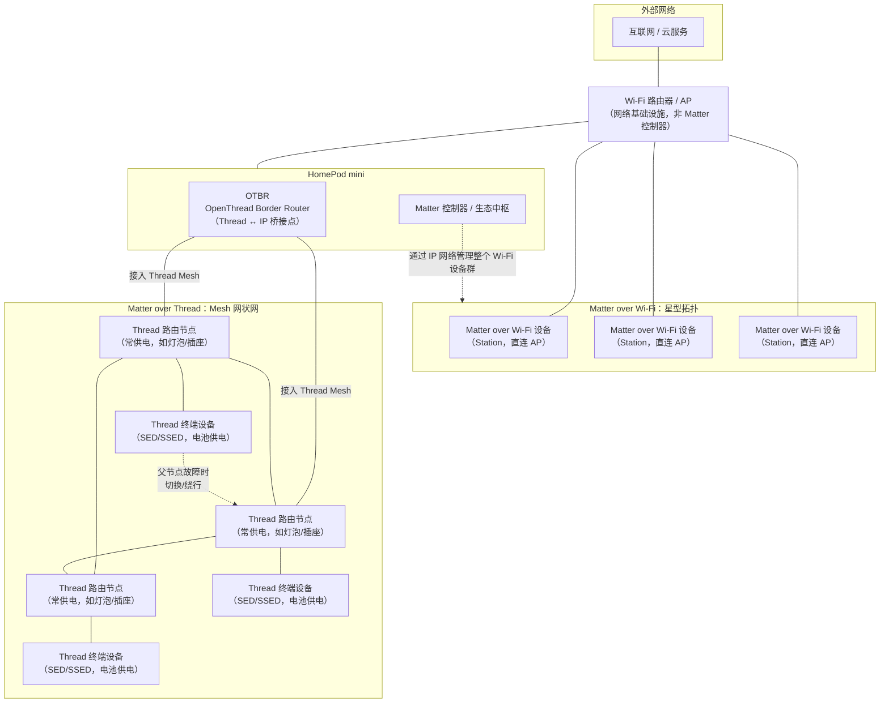

# Matter over Thread 与 Matter over Wi-Fi 对比

> Matter 是应用层协议，不定义物理层。Thread 与 Wi-Fi 是两种底层承载方式。**选择的核心不是“哪个更好”，而是“哪个匹配产品的供电模型、数据模型与目标用户的基础设施现状”**。下表以对比维度为行，在同一行内同时呈现技术差异、优劣判断与关键依据。

---

## 一、总对比表

| 对比维度 | Matter over Thread | Matter over Wi-Fi |
| :--- | :--- | :--- |
| **底层标准与频段** | IEEE 802.15.4，2.4 GHz 全球统一 | IEEE 802.11（Wi-Fi 4/5/6/7），2.4 / 5 / 6 GHz |
| **网络拓扑** | IPv6 **Mesh 网状网**。设备可扮演终端、路由节点、边界路由器。持续供电设备自动成为路由节点，扩展覆盖并增强自愈能力 | **星型拓扑**。所有设备为 Station，直连 AP/路由器。路径确定性高，但无自愈能力 |
| **带宽与吞吐** | **劣**。最大理论 250 Kbps，典型有效约 125 Kbps。仅够控制指令与传感器数值，**摄像头、视频流、音频流、复杂图形界面完全无法承载** | **优**。数十 Mbps 至 Gbps 级。足以支撑视频流、音频流、OTA 固件升级、中控屏 UI 渲染等大数据场景 |
| **功耗与电池续航** | **优**。原生支持休眠终端设备（SED/SSED）。纽扣电池传感器续航 **2~5 年**，门锁等设备可达数年。Matter 1.4 的 LIT（长空闲时间）ICD 模式与 Thread 天然契合，设备仅在 Check-In 时唤醒 | **劣**。Wi-Fi Station 必须周期性监听 DTIM Beacon 以接收下行数据。即使采用优化的选择性监听方案可将功耗降至 DTIM 模式的 20% 以下，绝对值仍远高于 Thread，且依赖 AP 配合。电池设备续航通常仅数周至数月 |
| **Matter ICD 模式适配** | **LIT（长空闲时间）天然适配**。空闲周期 ≥15 秒，设备深度休眠，控制器通过 Check-In Protocol 通信。Silicon Labs、Nordic 提供 功耗分析工具，可根据 LIT 设置直接估算电池寿命 | **通常为 SIT（短空闲时间）**。空闲周期 <15 秒。Wi-Fi 上的 LIT 是工程难题：需与 AP 协商非标准 DTIM 间隔，跨 AP 兼容性不可控。**这是 Wi-Fi 不适合电池传感器在协议层的根本原因，而非“优化不够”** |
| **基础设施门槛** | **劣**。**必须**有 Thread 边界路由器（TBR）。若用户家中没有 Apple TV、HomePod、Google Nest Hub 或 SmartThings Hub 等兼容设备，产品完全无法工作 | **优**。绝大多数家庭已有 Wi-Fi 路由器，设备配网后直接接入，**零额外硬件** |
| **边界路由器（TBR）** | TBR 仅做 IPv6 封包路由，**不做 Matter 应用层协议转换**。可集成于音箱、中控屏、路由器。Thread 1.4 起凭证共享为强制功能，多 TBR 可自动形成统一网络 | N/A（无 TBR 角色） |
| **网络自愈与单点故障** | **优**。Mesh 多跳 + 自修复。路由节点故障时毫秒级重算路径；多 TBR 冗余，一台离线不影响通信。断网或路由器故障时，Thread Mesh 内设备间本地通信仍可维持 | **劣**。星型拓扑，路由器重启、固件升级或宕机期间**所有设备同时离线**，自动化全部失效。路由器成为全局单点故障源 |
| **覆盖扩展方式** | **优**。“设备即路由”：常供电的 Thread 灯泡/插座自动成为路由节点，扩展网络无需额外硬件。节点越多，覆盖越广 | **劣**。需额外购买 Wi-Fi Mesh 系统、中继器或电力猫。信号穿墙衰减明显，边缘设备连接不稳 |
| **对 Wi-Fi 空口的影响** | **优**。使用独立 802.15.4 窄带跳频，不消耗 AP 连接数，不占用 Wi-Fi 空口时间。对家庭上网体验几乎无影响 | **劣**。每个 Wi-Fi 智能设备都消耗 AP 关联表项并占用 2.4 GHz 空口时间。大量设备时可能影响手机/电脑网络体验 |
| **实际延迟表现** | **劣，需限定场景**。Mesh 多跳虽增强可靠性，但每一跳增加转发延迟。实测中位端到端延迟约 **205ms**（p99 691ms）。Thread 的真实优势在于**断网下的本地自治与可靠性**，而非绝对延迟更低 | **优, 简单拓扑下**。单跳直连 AP，实测中位延迟可低至 **65ms** 量级。但该优势依赖 AP 覆盖良好；路由器故障时本地自动化随之失效 |
| **Thread 1.4 凭证共享** | **配网体验向 Wi-Fi 靠拢，但门槛未消除**。TBR 生成一次性密码，手机 App 获取后安全提取 Thread 凭证，新设备即可加入网络。用户不再需要理解“哪台是主 TBR”。**但仍需至少一台 Thread 1.4 认证的 TBR**。产品团队应在 App 配网流程中主动检测 TBR 是否存在，缺失时给出明确指引 | **N/A**。不依赖 TBR。Matter 1.4.2 已支持仅 Wi-Fi 配网，降低了早期 BLE 辅助配网的碎片化问题 |
| **混合部署中的 TBR 选址** | **位置与负载显著影响性能**。TBR 应置于家庭中心，与 AP 通过以太网或稳定 Wi-Fi 连接。智能音箱兼任 TBR 时，音频流与路由转发的资源竞争可能影响转发性能。建议至少部署**一台独立 TBR**，而非完全依赖音箱兼任 | **N/A（无 TBR 角色）**。但 AP 选址同样关键：大量智能设备接入时需评估 AP 关联表项上限与 2.4 GHz 空口负载 |
| **芯片成本与供应链** | **劣**。芯片出货规模小，单设备硅片成本与认证分摊成本更高。Silicon Labs、Nordic、Espressif 均有完整方案，但生态规模小于 Wi-Fi | **优**。受益于手机/PC 巨量出货，Wi-Fi 模组成本极具竞争力。开发工具链、参考设计、认证流程极成熟 |
| **配网与安装体验** | 依赖 TBR 在线；Thread 1.4 凭证共享后体验正在改善。用户认知门槛在于“边界路由器”概念 | **劣**。早期设备依赖 BLE 辅助配网；Matter 1.4.2 仅 Wi-Fi 配网已改善，但存量设备仍存碎片化 |
| **生态锁定与 Hub 依赖** | 不绑定特定品牌 Hub，但依赖 TBR 这一硬件角色。Thread 1.4 多厂商凭证共享正在削弱生态壁垒 | **优**。直接连路由器，不依赖品牌 Hub。更换生态或 Hub 时设备不受影响 |
| **典型适用设备** | 门锁、门窗/人体/温湿度传感器、无线开关、电池供电照明控制、常供电 Mesh 路由节点（灯泡/插座） | 摄像头、视频门铃、智能音箱、中控屏、扫地机器人、大型家电、需要高带宽的交互设备 |

---

## 二、BLE 在 Matter over Thread 与 Matter over Wi-Fi 中的角色对比

> BLE 在两种承载方式中都不是日常通信通道，而是**配网阶段的带外引导通道**。但两者对 BLE 的依赖程度、BLE 承载的信息内容以及配网完成后的退出机制存在明显差异。

| 对比维度 | BLE 在 Matter over Thread 中 | BLE 在 Matter over Wi-Fi 中 |
| :--- | :--- | :--- |
| **核心角色** | **配网引导 + Thread 凭证下发通道**。设备尚无 Thread 网络身份时，BLE 是控制器与其建立安全会话的唯一入口 | **配网引导 + Wi-Fi 凭证下发通道**。设备尚无 IP 地址时，BLE 是控制器与其建立安全会话的唯一入口 |
| **是否必需** | **通常必需**。设备出厂后没有 Thread 网络凭证，必须通过 BLE（或厂商自定义带外方式）完成 PASE 会话，才能接收 Thread 网络参数与 Matter 身份证书 | **早期必需，Matter 1.4.2 起可选**。早期 Wi-Fi 设备依赖 BLE 辅助配网；Matter 1.4.2 支持仅 Wi-Fi 配网后，BLE 不再是唯一路径，但存量设备仍普遍依赖 BLE |
| **BLE 广播携带的信息** | Discriminator（12 位，用于多设备场景下区分目标设备）、Vendor ID / Product ID（可选）、Extended Data（可选）。广播持续至设备加入第一个 Matter Fabric 后停止 | 与 Thread 侧相同：Discriminator、可选 Vendor ID / Product ID、可选 Extended Data。广播持续至配网完成 |
| **BLE 安全会话中下发的关键信息** | **Thread 网络凭证**（Network Name、Extended PAN ID、Network Key、Channel 等）、**Node Operational Certificate（NOC）**、**Trusted Root Certificate**。设备拿到这些信息后才能以合法身份加入 Thread Mesh 并与控制器建立 CASE 会话 | **Wi-Fi 凭证**（SSID、密码、安全类型）、**Node Operational Certificate（NOC）**、**Trusted Root Certificate**。设备拿到 Wi-Fi 凭证后才能接入 AP，进而获得 IP 地址并建立 CASE 会话 |
| **BLE 是否参与日常控制** | **不参与**。配网完成后 BLE 关闭，日常控制、状态上报、订阅全部走 Thread Mesh 上的 IPv6/CASE | **不参与**。配网完成后 BLE 关闭，日常控制、状态上报、订阅全部走 Wi-Fi 上的 IPv6/CASE |
| **BLE 退出时机** | 设备成功加入 Thread 网络并获得 Matter Fabric 身份后，BLE 广播停止，BLE 链路不再维持 | 设备成功接入 Wi-Fi 并获得 IP 地址、完成 CASE 会话建立后，BLE 广播停止，BLE 链路不再维持 |
| **对 BLE 的依赖强度** | **强**。Thread 设备没有其他标准化的“入网前通道”，BLE 是 Matter 规范中默认的配网承载 | **中→弱**。Matter 1.4.2 仅 Wi-Fi 配网提供了替代路径，但受存量设备与生态实现影响，BLE 仍是主流配网方式之一 |
| **配网失败时的 BLE 作用** | 若 Thread 凭证下发失败或设备无法加入 Mesh，BLE 会话可保持以重试；但若 TBR 不在线，BLE 无法解决“无 Thread 网络可加入”的根本问题 | 若 Wi-Fi 凭证错误或 AP 不可达，BLE 会话可保持以重新下发凭证；BLE 本身不依赖 TBR，失败原因通常集中在 AP 侧 |
| **与 TBR 的关系** | BLE 只负责把 Thread 凭证交给设备；**设备能否真正入网取决于 TBR 是否在线且可加入**。BLE 不能替代 TBR | 无 TBR 角色。BLE 只负责把 Wi-Fi 凭证交给设备；设备能否入网取决于 AP 是否可达 |
| **安全边界** | BLE 链路使用 PASE 建立临时安全会话，凭证传输加密；配网完成后该临时信任关系终止，后续以 NOC 为基础的 CASE 为准 | 同左：PASE 临时安全会话传输 Wi-Fi 凭证与 NOC；配网完成后 BLE 信任关系终止，后续以 CASE 为准 |
| **典型用户感知** | 用户通常感知为“用手机 App 配网”，底层是 BLE 把 Thread 凭证交给设备；Thread 1.4 凭证共享后，BLE 仍承担设备与手机之间的初始安全通道 | 用户同样感知为“用手机 App 配网”，底层是 BLE 把 Wi-Fi 密码交给设备；Matter 1.4.2 仅 Wi-Fi 配网试图减少对 BLE 的依赖 |
| **一句话总结** | BLE 是 Thread 设备的“临时脐带”：在设备没有 Thread 身份时完成发现与凭证下发，入网即剪断 | BLE 是 Wi-Fi 设备的“临时脐带”：在设备没有 IP 地址时完成发现与 Wi-Fi 凭证下发，入网即剪断；Matter 1.4.2 起这根脐带开始变为可选 |

---

## 三、选型建议与产品决策参考

### 按设备类型快速决策

| 设备类型 | 推荐传输 | 核心理由 |
| :--- | :--- | :--- |
| 门窗传感器 / 人体传感器 | **Thread** | 电池供电，LIT ICD，小数据包，续航 2~5 年 |
| 智能门锁 | **Thread** | 电池供电，需长续航；SIT 模式可平衡响应与功耗 |
| 无线开关 / 场景按钮 | **Thread** | 电池供电，事件驱动，极低频通信 |
| 温湿度 / 光照传感器 | **Thread** | 低功耗，周期性小数据上报 |
| 智能灯泡 / 插座（常供电） | **Thread** | 可作为 Mesh 路由节点增强网络；自身控制数据量小 |
| 摄像头 / 视频门铃 | **Wi-Fi** | 高带宽视频流，Thread 物理层无法承载 |
| 智能音箱 / 中控屏 | **Wi-Fi** | 音频流、图形界面、常供电 |
| 扫地机器人 / 大型家电 | **Wi-Fi** | 常供电，地图数据与固件升级需求较大 |
| 电池供电温控器（仅显示温度） | **Thread** | 低功耗优先；若带常供电大屏则转 Wi-Fi |

### 混合部署架构建议

- **Thread 层**：低功耗传感、门锁、开关 + 常供电灯泡/插座（兼做路由节点）。
- **Wi-Fi 层**：摄像头、音箱、中控屏、家电。
- **TBR 层**：至少一台**独立 TBR**（非音箱兼任）置于家庭中心，通过以太网连接 AP；音箱 TBR 作为冗余。
- **控制器**：Matter 控制器同时管理两层，用户无需感知底层差异。

### 产品团队决策清单

1. **供电模型决定一切**：电池供电 → **Thread 是唯一合理选择**。常供电 → 可评估 Wi-Fi。
2. **数据吞吐是硬约束**：视频/音频/大文件 → Wi-Fi，无替代方案。
3. **目标用户是否已有 TBR**：若面向大众市场且无法确保 TBR 存在，**Wi-Fi 是更安全的默认选择**；若面向 Apple/Google/Amazon 生态用户，Thread 可行。
4. **延迟要求需区分场景**：若要求极低控制延迟（如灯光随动），Wi-Fi 单跳直连可能优于 Thread 多跳；若要求**断网下的本地自治**，Thread Mesh 是唯一选择。
5. **成本敏感度**：极致 BOM 成本 → Wi-Fi；可接受溢价换取低功耗体验 → Thread。
6. **产品在 Mesh 中的角色**：若产品常供电且位置居中，选 Thread 可兼做路由节点，提升整体网络质量——这是 Wi-Fi 产品无法提供的价值。

---

## 四、演进趋势与核心判断

**Thread 1.4** 的凭证共享是 Thread 生态走向“用户无感”的关键一步：TBR 强制支持一次性密码分享，新设备配网不再需要用户理解“哪台是主 TBR”。Apple TV 与 Google TV Streamer 已率先支持。但 **TBR 的硬件存在仍是前提**，无 TBR 家庭中 Thread 设备依然无法工作。

**Matter 1.4.1** 的 ICD 集群规范明确了 SIT/LIT 的边界，为设备厂商提供了统一的功耗声明框架。**Matter 1.4.2** 的仅 Wi-Fi 配网降低了 Wi-Fi Matter 设备的硬件门槛，但并未改变 Wi-Fi 在电池场景下的物理层劣势。

**核心判断**：Thread 与 Wi-Fi 不是竞争关系，而是**互补的承载层**。产品决策应基于供电方式、数据模型与目标用户的基础设施现状做**约束求解**。对于同时覆盖两类设备的智能家居产品线，**混合部署 + 统一 Matter 控制器**是唯一合理的架构选择。